# Отчёт. Лабораторная работа 2 (Docker)

Создаем плохой образ так его и называем ( он плох тем что нет ни версий ни ignor , все сохраняется все пароли и тд , пересборка долгая , работаем в root )

## Плохой образ

Плохой докер:

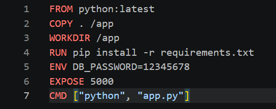

Сначала мы запускает контейнер (это уже рабочий вариан) и спрашивает, под каким пользователем работает процесс

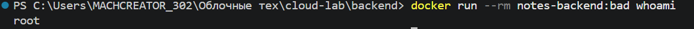

пересобирает образ с секундомером

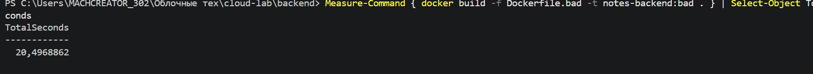

Размер:

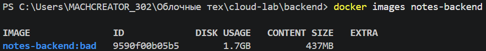

## Хороший образ

Создаем хороший докер

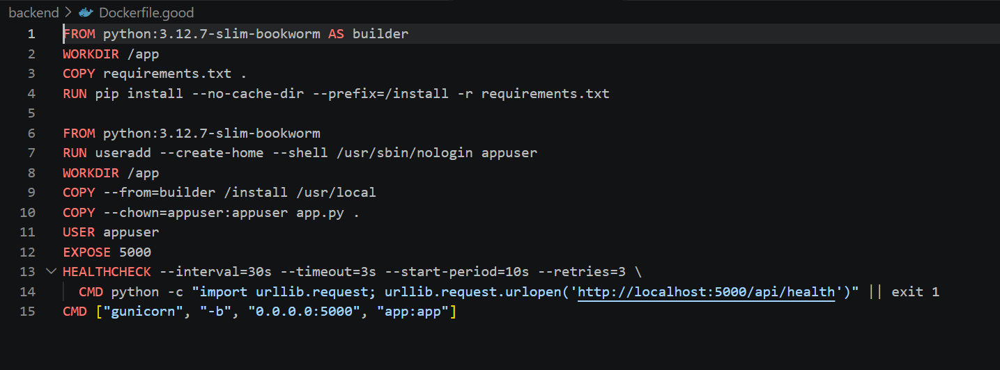

Сравнение

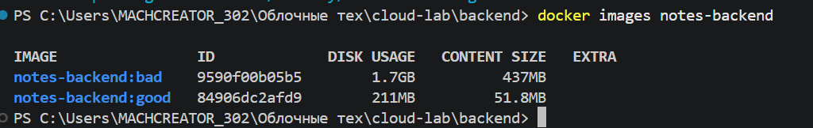

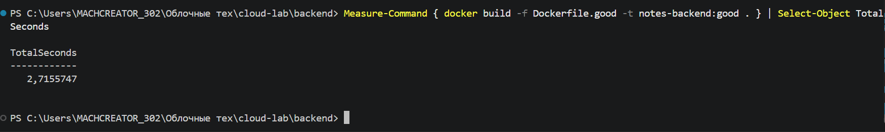

## Фронтенд и nginx

Создаем фронтенд докер

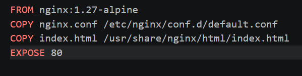

Создаем frontend/nginx.conf

nginx –это веб-сервер: программа, которая отдаёт браузеру страницу сайта и пересылает запросы /api/... бэкенду. В вашей лабе он работает в отдельном контейнере для фронтенда на порту 80.

Поменяли это

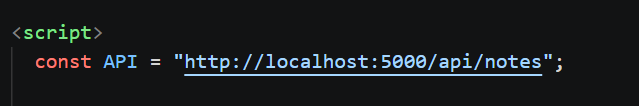

На это

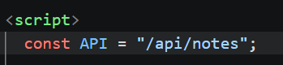

Чтобы он работал через nginx а не просто в порт стучался)

## База данных и compose

Создаем init.sql

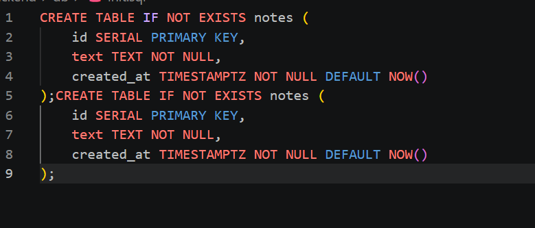

Чтобы когда проект загружали на другой комп у них и sql работал , ну это еще нужно для compose docker , ну как раз чтобы все собрать

Создаем файл docker-compose

```yaml
services:
  db:
    image: postgres:16-alpine
    environment:
      POSTGRES_DB: ${DB_NAME}
      POSTGRES_USER: ${DB_USER}
      POSTGRES_PASSWORD: ${DB_PASSWORD}
    volumes:
      - pgdata:/var/lib/postgresql/data
      - ./db/init.sql:/docker-entrypoint-initdb.d/init.sql:ro
    networks:
      - backend_net
  backend:
    build:
      context: ./backend
      dockerfile: Dockerfile.good
    environment:
      DB_HOST: db
      DB_PORT: 5432
      DB_NAME: ${DB_NAME}
      DB_USER: ${DB_USER}
      DB_PASSWORD: ${DB_PASSWORD}
    depends_on:
      - db
    networks:
      - frontend_net
      - backend_net
  frontend:
    build: ./frontend
    ports:
      - "8080:80"
    depends_on:
      - backend
    networks:
      - frontend_net
volumes:
  pgdata:
networks:
  frontend_net:
  backend_net:
```

создаем и запускаем контейнер:

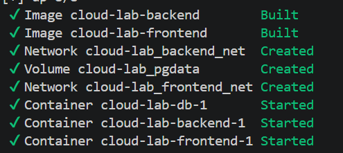

и выводим его данные:

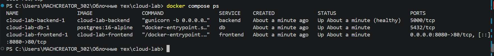

## Проверки

1) Заходим не под root

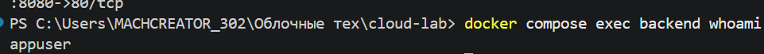

2) Переходим по ссылке http://localhost:8080/

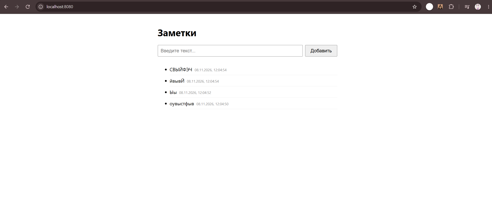

3) Данные переживут если мы закроем сессию

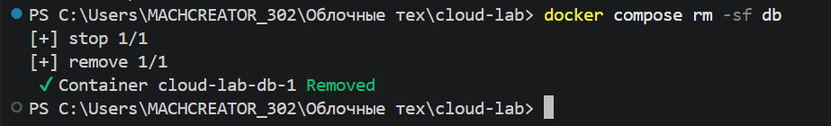

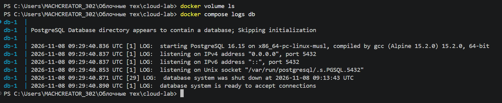


Заметки остались)

4) Фронтенд изолировал

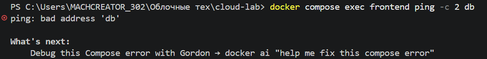

5) Проверка подключен ли backend к db

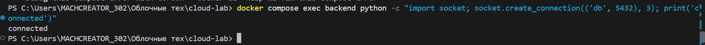

## Часть со звёздочкой

Мы переписываем docker-compose добавляем состояние здоровья ,автоматический перезапуск и порядок запуска

```yaml
services:
  db:
    image: postgres:16-alpine
    restart: unless-stopped
    environment:
      POSTGRES_DB: ${DB_NAME}
      POSTGRES_USER: ${DB_USER}
      POSTGRES_PASSWORD: ${DB_PASSWORD}
    volumes:
      - pgdata:/var/lib/postgresql/data
      - ./db/init.sql:/docker-entrypoint-initdb.d/init.sql:ro
    healthcheck:
      test: ["CMD-SHELL", "pg_isready -U $${POSTGRES_USER} -d $${POSTGRES_DB}"]
      interval: 5s
      timeout: 3s
      retries: 10
      start_period: 10s
    networks:
      - backend_net
  backend:
    build:
      context: ./backend
      dockerfile: Dockerfile.good
    restart: unless-stopped
    environment:
      DB_HOST: db
      DB_PORT: 5432
      DB_NAME: ${DB_NAME}
      DB_USER: ${DB_USER}
      DB_PASSWORD: ${DB_PASSWORD}
    depends_on:
      db:
        condition: service_healthy
    healthcheck:
      test: ["CMD", "python", "-c", "import urllib.request; urllib.request.urlopen('http://localhost:5000/api/health')"]
      interval: 5s
      timeout: 3s
      retries: 5
      start_period: 10s
    networks:
      - frontend_net
      - backend_net
  frontend:
    build: ./frontend
    restart: unless-stopped
    ports:
      - "8080:80"
    depends_on:
      backend:
        condition: service_healthy
    healthcheck:
      test: ["CMD", "wget", "-q", "-O", "/dev/null", "http://127.0.0.1/"]
      interval: 5s
      timeout: 3s
      retries: 5
    networks:
      - frontend_net
volumes:
  pgdata:
networks:
  frontend_net:
  backend_net:
```

заново пере собираем

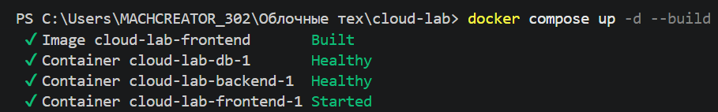

Теперь все по очереди запускается

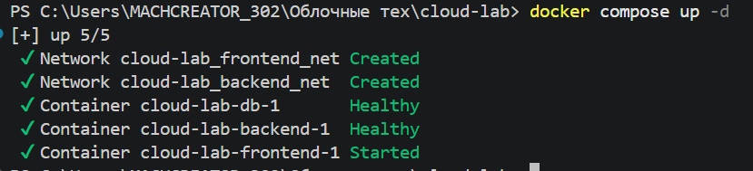

Уронили сервис

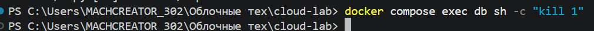

Так как сервис моментально перезагрузился этого даже не видно было

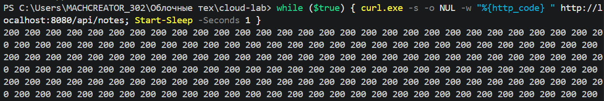

Но вот здесь видно что все таки все работает))

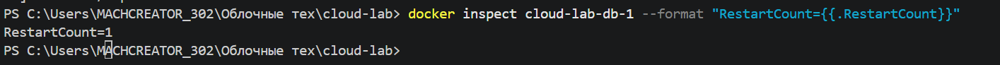

Перезапуск все таки произошел)

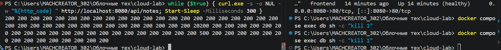

Решили сделать промежутки измерения меньше вот теперь видно один раз 500 а дальше 200 снова

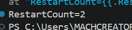

Запускаем программу ab чтобы максимально нагрузить сайт нагружаем на 3000 пользователей одновременно 30

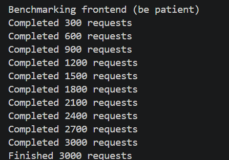

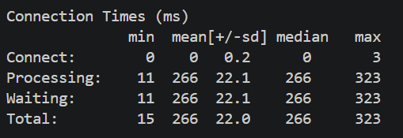

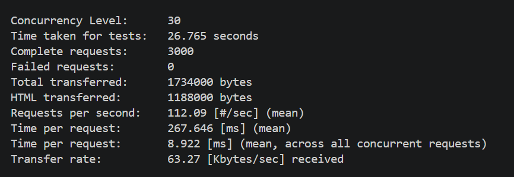

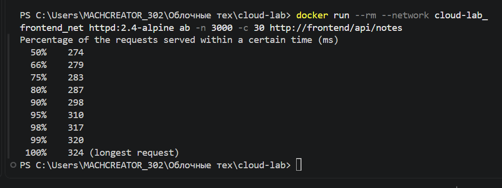

Docker stat

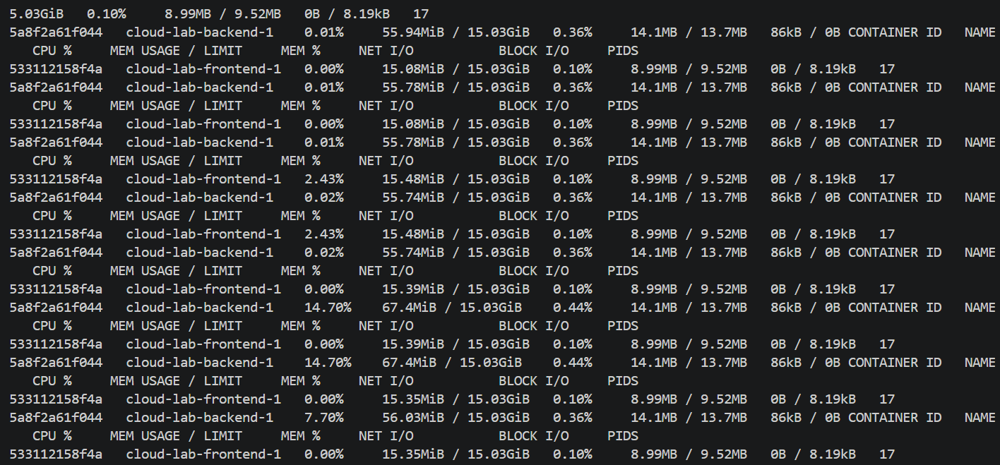

Воть в целом это все ,спасибо что все прочли , писали своими словами не судите строго


