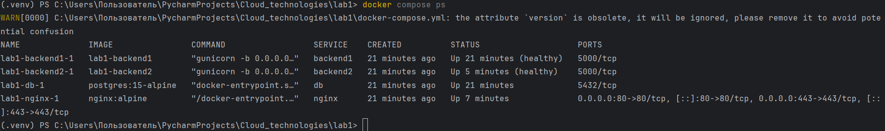
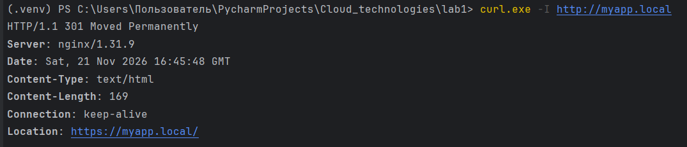
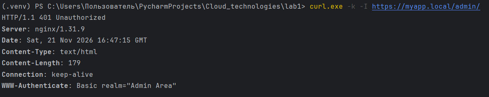
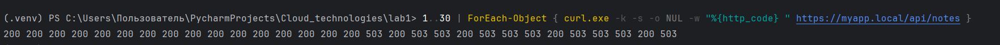
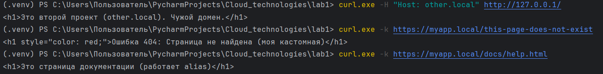
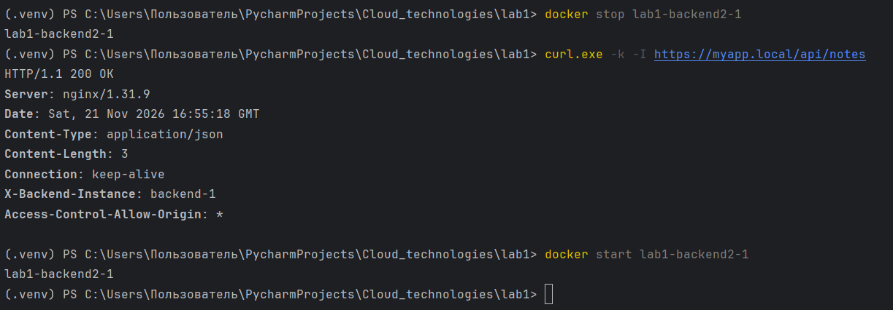

# Отчёт. Лабораторная работа 1 (Nginx)

## Вступление

Главная цель - чтобы сайт работал по HTTPS, защищал админку паролем и не падал, если один из бэкендов умер. Мы подняли две копии бэкенда и поставили перед ними Nginx, который распределяет запросы.

## Что мы настроили (конфиг nginx.conf)

Мы создали файл `lab1/nginx.conf`. Вот что он делает:

1. **HTTPS и редирект:** Мы сгенерировали самоподписанный SSL-сертификат. Теперь Nginx слушает 443 порт, а все запросы на 80 порт принудительно перенаправляет на 443.
2. **Балансировка (upstream):** В конфиге мы описали `upstream backend_pool` с двумя серверами `backend1` и `backend2`. Для наглядности мы добавили в код бэкенда (`app.py`) вывод заголовка `X-Backend-Instance`, чтобы видеть, кто именно ответил.
3. **Фронт и Бэк:** Nginx сам отдает нашу страницу с заметками из папки `frontend`, а запросы на `/api` перекидывает на бэкенды.
4. **Alias для /docs:** Мы сделали так, чтобы по пути `/docs/` отдавались файлы из отдельной папки.
5. **Виртуальные хосты:** Настроили два домена: `myapp.local` (основной сайт) и `other.local` (второй проект). Nginx четко разводит их, чтобы `other.local` не показывал лишнего
6. **Ограничение частоты (limit_req):** Поставили лимит на `/api`, чтобы защитить бэкенд от флуда.
7. **Своя 404:** Сделали красивую кастомную страницу ошибки вместо стандартной.
8. **Админка (/admin):** Закрыли паролем (сделали файл `htpasswd` с логином `admin` и паролем `secret`).

## Запуск и проверки

Мы подняли всё это через `docker-compose.yml`. Он собирает два бэкенда, базу и сам Nginx



### 1. Проверка редиректа
Идем на HTTP, получаем 301 (редирект на HTTPS).

```bash
curl.exe -I http://myapp.local
```


### 2. Проверка балансировки
Делаем несколько запросов подряд и смотрим заголовок X-Backend-Instance. Запросы чередуются между backend-1 и backend-2. Это значит, что Nginx распределяет нагрузку поровну.

### 3. Проверка админки (закрыта)
Путь /admin/ закрыт базовой авторизацией. Без пароля не пускает, отдает 401 Unauthorized



### 4. Проверка флуда (Ограничение частоты)
Отправляем сразу много запросов. Nginx срабатывает как защитник и начинает отдавать 503 (Service Unavailable), потому что наш бэкенд не справляется с такой кучей запросов сразу. Это доказывает, что защита limit_req работает



### 5. Проверка второго домена (other.local)
Запрос с другим заголовком Host перенаправляется на второй сайт. Nginx отдает только его проект, не путая с основным

### 6. Проверка кастомной 404
Запрос на несуществующую страницу отдает нашу страницу ошибки

### 7. Проверка Alias (/docs)
По пути /docs/ Nginx отдает документацию из отдельной папки

Вот 5-7 пункты:



### Главный результат: Отказоустойчивость
Мы уронили один бэкенд, и проверили, что сайт продолжает работать

Остановили второй контейнер:

```bash
docker stop lab1-backend2-1
```
Проверили API:

```bash
curl.exe -k -I https://myapp.local/api/notes
```
Сайт жив, Nginx сразу переключил все запросы на живую копию, и пользователи ничего не заметили


### Вывод
Мы получили работающую, отказоустойчивую конфигурацию Nginx, которая держит сайт живым даже при падении половины бэкенда, защищает важные разделы и умеет разводить трафик по разным доменам

