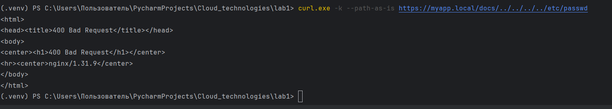
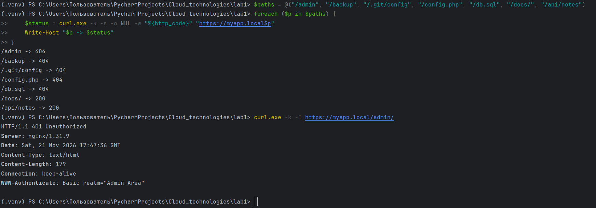
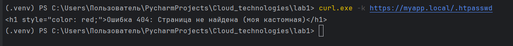

# Часть со звёздочкой: Поиск уязвимостей

Для выполнения этого задания я выбрала **свой собственный локальный сайт** (`myapp.local`), а не сторонний ресурс из интернета. 

**Почему именно так:**
Вообще, как и написано в задании использовать уязвимости на сайтах незаконным и даже если мы отправляем безобидные запросы, это уже попытка залезть к кому-то :( 
Да и цель лабы — узнать, как работают уязвимости, чтобы не допускать таких ошибок в конфигурации своего собственного Nginx в будущем. Проверка на локальном стенде дает понимание механизмов защиты, не причиняя вреда другим, извините


### 1. Path Traversal (Обход путей)
Попытка выйти за пределы директории `/docs/` и прочитать системный файл `/etc/passwd` с помощью `../`.
```bash
curl.exe -k --path-as-is https://myapp.local/docs/../../../../etc/passwd
```
Nginx вернул 400 Bad Request. Сервер распознал попытку выхода за пределы разрешенной директории и заблокировал её на уровне парсинга URL. Уязвимость отсутствует :)))



### 2. Перебор скрытых страниц (Fuzzing)
Имитация работы утилиты ffuf — проверка наличия бэкапов, конфигов и скрытых директорий

```bash
$paths = @("/admin", "/backup", "/.git/config", "/config.php", "/db.sql", "/docs/", "/api/notes")
foreach ($p in $paths) {
    $status = curl.exe -k -s -o NUL -w "%{http_code}" "https://myapp.local$p"
    Write-Host "$p -> $status"
}
```

Скрытые файлы (/.git/config, /backup, /config.php) вернули 404 Not Found. Рабочий API /api/notes вернул 200. Доступа к лишним файлам нет



Дополнительно проверена админка. Запрос на /admin (без слэша) вернул 404, а на /admin/ — 401 Unauthorized (доступ закрыт базовой авторизацией)

### 3. Проверка доступа к файлу паролей
Попытка скачать файл .htpasswd, в котором хранятся логины и пароли от админки.

```bash
curl.exe -k https://myapp.local/.htpasswd
```

404 Not Found (отобразилась наша страница ошибки). Файл лежит вне корневой директории сайта и недоступен извне



### Вывод
Конфигурация Nginx безопасна. Проведённые проверки показали, что сервер правильно обрабатывает запросы с ../, не отдаёт скрытые файлы и защищает важные разделы авторизацией. Уязвимостей вроде нету :))


